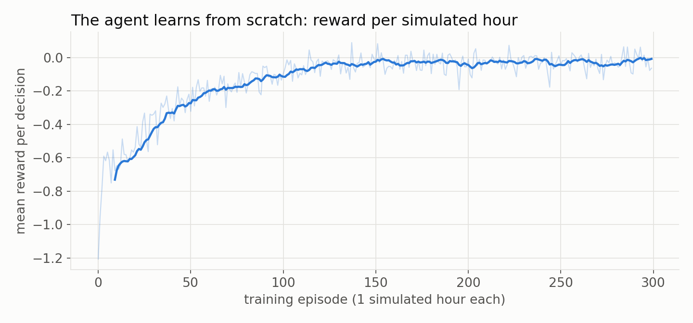
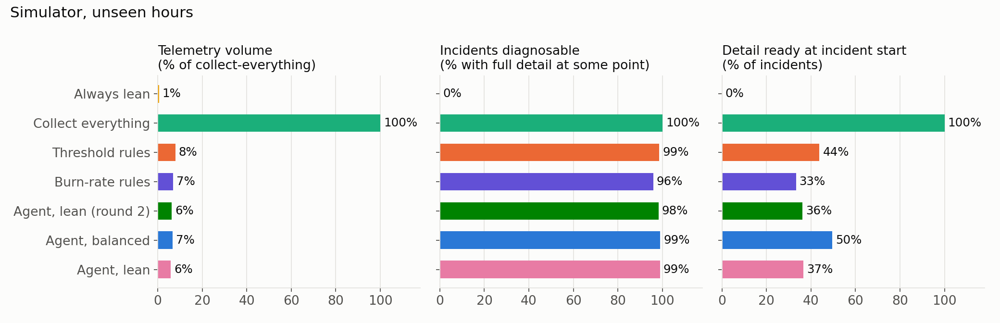
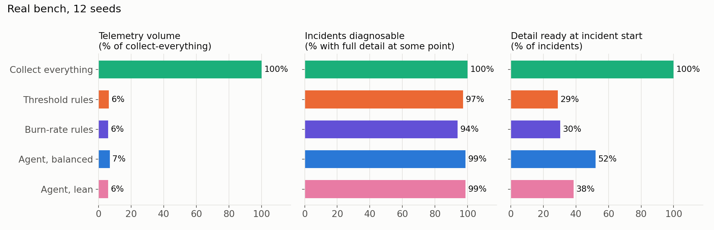

# Results

## Training

## Simulator: 40 held-out episodes x 60 min, with measured reading errors

| Policy | Samples | Spans | Volume vs full | Incidents diagnosable | Ready at start | Detect (s) | To full detail (s) | Changes / service-hour |
|---|---:|---:|---:|---:|---:|---:|---:|---:|
| Always lean | 576,000 | 201,392 | 0.6% | 0/855 | 0 | 14.6 | nan | 0.0 |
| Collect everything | 423,360,000 | 20,139,187 | 100.0% | 853/853 | 853 | 4.8 | 0.0 | 1.0 |
| Threshold rules | 14,736,540 | 2,491,809 | 7.9% | 828/840 | 368 | 11.5 | 9.4 | 8.8 |
| Burn-rate rules | 12,566,013 | 2,158,763 | 6.8% | 802/836 | 278 | 12.1 | 20.2 | 10.0 |
| Agent, lean (round 2) | 12,717,077 | 1,939,668 | 6.3% | 826/841 | 304 | 12.5 | 10.8 | 21.3 |
| Agent, balanced | 12,869,853 | 2,089,275 | 6.7% | 836/844 | 418 | 9.3 | 6.0 | 14.6 |
| Agent, lean | 11,361,353 | 1,834,336 | 5.9% | 835/844 | 309 | 10.8 | 7.8 | 16.6 |

## Real bench: 12 seeds x 60 min per policy, each policy on its own copy of the bench, same load and faults

| Policy | Samples | Spans | Volume vs full | Incidents diagnosable | Ready at start | Detect (s) | To full detail (s) | Changes / service-hour |
|---|---:|---:|---:|---:|---:|---:|---:|---:|
| Collect everything | 126,941,360 | 5,626,797 | 100.0% | 226/226 | 226 | 6.1 | nan | 1.0 |
| Threshold rules | 3,661,240 | 555,926 | 6.4% | 219/225 | 65 | 12.6 | 10.8 | 9.1 |
| Burn-rate rules | 3,354,300 | 513,647 | 5.9% | 216/230 | 70 | 12.7 | 20.5 | 9.3 |
| Agent, balanced | 3,958,960 | 592,665 | 6.8% | 233/236 | 123 | 11.5 | 6.4 | 18.5 |
| Agent, lean | 3,491,300 | 513,118 | 5.9% | 236/239 | 92 | 11.9 | 7.4 | 22.6 |

Per seed: volume vs collect-everything · incidents diagnosable

| Seed | Collect everything | Threshold rules | Burn-rate rules | Agent, balanced | Agent, lean |
|---|---:|---:|---:|---:|---:|
| 5301 | 100.0% · 18/18 | 6.1% · 19/20 | 5.8% · 20/22 | 6.5% · 23/23 | 5.3% · 22/23 |
| 5302 | 100.0% · 30/30 | 8.8% · 23/25 | 7.7% · 23/25 | 9.9% · 25/25 | 8.9% · 27/28 |
| 5303 | 100.0% · 15/15 | 6.7% · 15/15 | 5.8% · 15/15 | 6.1% · 16/16 | 6.0% · 15/15 |
| 5304 | 100.0% · 20/20 | 6.1% · 21/23 | 5.9% · 19/23 | 7.2% · 25/26 | 6.1% · 28/29 |
| 5401 | 100.0% · 21/21 | 6.9% · 21/21 | 6.5% · 19/21 | 6.9% · 21/21 | 6.3% · 21/21 |
| 5402 | 100.0% · 16/16 | 5.9% · 16/16 | 5.4% · 16/16 | 6.4% · 16/16 | 5.4% · 16/16 |
| 5403 | 100.0% · 26/26 | 6.7% · 25/26 | 6.3% · 22/24 | 7.1% · 27/28 | 6.2% · 22/22 |
| 5404 | 100.0% · 11/11 | 4.5% · 11/11 | 4.0% · 13/14 | 6.0% · 11/11 | 4.9% · 17/17 |
| 5501 | 100.0% · 19/19 | 5.8% · 18/18 | 5.5% · 16/17 | 6.1% · 17/17 | 5.4% · 17/17 |
| 5502 | 100.0% · 13/13 | 5.7% · 13/13 | 5.4% · 16/16 | 6.2% · 15/16 | 5.4% · 13/13 |
| 5503 | 100.0% · 20/20 | 6.8% · 20/20 | 6.1% · 19/19 | 6.4% · 20/20 | 5.6% · 21/21 |
| 5504 | 100.0% · 17/17 | 6.6% · 17/17 | 6.2% · 18/18 | 7.2% · 17/17 | 6.0% · 17/17 |

Definitions: an incident is 3+ consecutive 5 s ticks with true p99 > 300 ms or errors > 2% on a service.
Diagnosable = level L3 or higher (detail metrics, 5 s scrape, 25% traces). Detect = time until the
collected telemetry itself shows the breach. Samples = samples ingested by Prometheus after relabelling.
